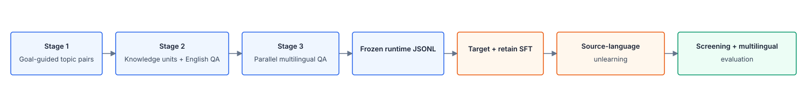

<div align="center">

# CLLPU

### Beyond Cross-Lingual Transfer

**Benchmarking propagation boundaries in multilingual LLM unlearning**

[](#benchmark-snapshot)
[](#benchmark-snapshot)
[](#unlearning)
[](#evaluation)

[Pipeline](#benchmark-pipeline) ·
[Data](data/) ·
[Runtime](#runtime-workflow) ·
[Model switching](#switching-models) ·
[Random seeds](#repeating-a-seed0-selection) ·
[Evaluation](#evaluation) ·
[Quick start](#quick-start)

</div>

---

> **CLLPU evaluates not only whether knowledge is forgotten, but how the
> forgetting effect propagates across languages.**

## About This Repository

CLLPU is a benchmark and reference runtime for cross-lingual LLM unlearning.
It covers Arabic, Bengali, German, English, Spanish, French, Japanese,
Swahili, Thai, and Chinese. The repository contains the established benchmark
construction resources, the frozen training/evaluation snapshot, and the
CLLPU runtime for target-model SFT, retain-reference SFT, seven unlearning
methods, checkpoint screening, multilingual evaluation, and result export.

## What the Runtime Provides

| Capability | Implementation |
| --- | --- |
| Model preparation | Target-model SFT and independently initialized retain-reference SFT |
| Unlearning settings | Common and Culture-origin |
| Methods | GradAscent, GradDiff, NPO, SimNPO, BalDRO-NPO, BalDRO-SimNPO, Combined |
| Model support | Llama-3.1-8B-Instruct and Qwen2.5-14B-Instruct |
| Seed repetitions | Freeze a seed0 configuration and selected step; repeat seeds 1, 2, 3, 4 |
| Checkpoint screening | Source-language-only Exact and ROUGE-L during training |
| Post-selection evaluation | Common, one Culture origin, or unified multilingual full evaluation |
| Optional metrics | Pinned BGE-M3, five-level semantic judge, source-language MIA, ten-language Belebele |
| Result export | One-method long CSV and partial or complete source-by-evaluation-language matrices |

The paper-facing method names are `BalDRO-NPO` and `BalDRO-SimNPO`. Their
runtime/CLI identifiers are `drnpo` and `drsimnpo`, respectively; commands,
configuration overrides, and machine-readable metadata use these identifiers.

Start with [model switching](#switching-models) to select a model family, and
[random seeds](#repeating-a-seed0-selection) to repeat a selected experiment.
The runtime provides reusable interfaces, without historical parameter tables,
per-language selected configurations, result bundles, or model weights.
Combined's data construction and objective are documented in
[generic extensions](runtime/GENERIC_EXTENSIONS.md).

For a new backbone, follow **model preparation → seed0 unlearning and selection
→ fixed-selection seed repetitions → evaluation**. Run this workflow separately
for each setting, method, and source language. A selected Llama run is not a
Qwen configuration: prepare and select the Qwen seed0 run first.

## Benchmark Pipeline

<p align="center">
  
</p>

The existing construction resources remain under
[`stage_1_topic_pairs/`](stage_1_topic_pairs/),
[`stage_2_knowledge_to_qa/`](stage_2_knowledge_to_qa/),
[`stage_3_multilingual_translation/`](stage_3_multilingual_translation/), and
[`code/`](code/). The model runtime consumes the reviewed files under
[`runtime/data/multilingual/`](runtime/data/multilingual/) and does not rebuild
them during an experiment.

## Benchmark Snapshot

| Setting | Topic pairs | Forget-retain pairs | Matched QA |
| --- | ---: | ---: | ---: |
| Common | 50 | 500 | 40,000 |
| Culture-origin | 30 | 300 | 24,000 |
| **Total** | **80** | **800** | **64,000** |

The unified full evaluation contains 64,000 target/neighbor core+surface
records. An additional 8,000 core holdout records support MIA, giving 72,000
QA instances in the complete benchmark release. MIA holdouts are excluded from
ordinary full evaluation.

Existing source filenames use `.culture_specific`; the runtime calls the
corresponding experimental unit a Culture origin. This legacy field and
filename are retained for data compatibility.

## Runtime Workflow

```text
Base instruction model + matching model/tokenizer configuration
  -> Target-model SFT / Retain-reference SFT
  -> Common or Culture-origin unlearning
  -> source-language Exact/ROUGE checkpoint screening
  -> checkpoint selection on seed0
     -> optional seed repetitions at the same step and original LR schedule
  -> standalone multilingual generation and Exact/ROUGE evaluation
     -> optional BGE-M3 and semantic scoring of saved generations
     -> optional source-language MIA checkpoint evaluation
     -> optional ten-language Belebele checkpoint evaluation
  -> one-method CSV and source-by-evaluation-language matrix export
```

Training-time screening never includes cross-language results. Multilingual
evaluation is a separate post-selection operation, so cross-language behavior
cannot influence the initial checkpoint screen.

## Quick Start

### Installation

The paper environment uses Python 3.11. `requirements.txt` records the pinned
direct Python dependencies; system drivers, CUDA toolkits, and compilers remain
machine-specific.

```bash
git clone https://github.com/CLLPU/CLLPU-bench.git
cd CLLPU-bench
python3.11 -m venv .venv
source .venv/bin/activate
python -m pip install --upgrade pip setuptools wheel
python -m pip install -r requirements.txt
python -m pip install -e . --no-deps
```

The installation also provides the equivalent `cllpu-train` and `cllpu-eval`
console entry points. The examples below use `python -m cllpu.train` and
`python -m cllpu.eval` so the invoked module is explicit.

Meta Llama 3.1 is gated. Accept its license and authenticate before use:

```bash
huggingface-cli login
```

The paper configuration uses `flash_attention_2`. For a portable smoke test,
explicitly override it with `model.model_args.attn_implementation=sdpa`; that
override is not the paper configuration.

### Runtime Data

The reviewed 72-file JSONL snapshot is already under
`runtime/data/multilingual`. To use an identical snapshot stored elsewhere:

```bash
export CROSS_LINGUAL_DATA_DIR=/path/to/data
```

The expected schema, layout, and counts are documented in
[`runtime/data/README.md`](runtime/data/README.md).

## Model Preparation

Unless explicitly overridden, the canonical base configuration uses
`meta-llama/Meta-Llama-3.1-8B-Instruct` and the tested immutable revision in
[`runtime/configs/model/Llama-3.1-8B-Instruct.yaml`](runtime/configs/model/Llama-3.1-8B-Instruct.yaml).

Select a family configuration and give its outputs a separate directory:

```bash
export MODEL_CONFIG=Llama-3.1-8B-Instruct
# To use Qwen instead: export MODEL_CONFIG=Qwen2.5-14B-Instruct
export SFT_ROOT="outputs/finetune/$MODEL_CONFIG"
export CROSS_LINGUAL_TARGET_MODEL="$SFT_ROOT/target"
```

### Target Model

The default recipe trains the Target model on all 16,000 Common+Culture
target/neighbor core records for five epochs with batch size 8 and gradient
accumulation 4. Override these training settings for your experiment as needed:

```bash
python -m cllpu.train \
  --config-name=train.yaml \
  experiment=finetune/multilingual/default \
  model="$MODEL_CONFIG" \
  task_name="${MODEL_CONFIG}_target" \
  paths.output_dir="$CROSS_LINGUAL_TARGET_MODEL" \
  save_final_model=true
```

### Retain-Reference Model

The Retain-reference model is initialized independently from the same selected
base model and trained on all 8,000 Common+Culture neighbor/core records:

```bash
python -m cllpu.train \
  --config-name=train.yaml \
  experiment=finetune/multilingual/retain_reference \
  model="$MODEL_CONFIG" \
  task_name="${MODEL_CONFIG}_retain_reference" \
  paths.output_dir="$SFT_ROOT/retain_reference" \
  save_final_model=true
```

Although its training data contains neighbor/core examples from both settings,
the Retain-reference model is used only as the Common-setting reference. It is
not used as a Culture-setting reference.

## Switching Models

Model selection has two parts: the **model family configuration** chooses
tokenization/templates and loading options; the **weight path** chooses the
base or fine-tuned model. Change both consistently for training and generation
evaluation. Changing a path alone can leave the wrong chat template active.

| Model configuration | Default base model | Assistant ending |
| --- | --- | --- |
| `Llama-3.1-8B-Instruct` | `meta-llama/Meta-Llama-3.1-8B-Instruct` | Existing Llama preprocessing, unchanged |
| `Qwen2.5-14B-Instruct` | `Qwen/Qwen2.5-14B-Instruct` | Native `<\|im_end\|>`; no extra appended EOS |

For example, Qwen target SFT uses the same entry point and data recipe:

```bash
python -m cllpu.train \
  --config-name=train \
  experiment=finetune/multilingual/default \
  model=Qwen2.5-14B-Instruct \
  task_name=Qwen2.5-14B-Instruct_target \
  paths.output_dir=outputs/finetune/Qwen2.5-14B-Instruct/target \
  save_final_model=true
```

For retain-reference SFT, replace the experiment with
`finetune/multilingual/retain_reference` and use a separate task/output name.
Start it from the same base model, not the target SFT checkpoint. These examples
inherit the existing recipe's training parameters; they do not claim a fixed
Qwen paper setting or that 14B full-parameter training fits on one GPU.

For local base weights, additionally set **both**
`model.model_args.pretrained_model_name_or_path` and
`model.tokenizer_args.pretrained_model_name_or_path` to matching local paths.
Pin `model.model_args.revision` and `model.tokenizer_args.revision` explicitly
when using immutable Hub revisions.

For unlearning, `target_model` is the initial **target SFT** model. For example:

```bash
export MODEL_CONFIG=Qwen2.5-14B-Instruct
export CROSS_LINGUAL_TARGET_MODEL=outputs/finetune/Qwen2.5-14B-Instruct/target

python -m cllpu.train \
  --config-name=unlearn \
  experiment=unlearn/multilingual/default \
  model="$MODEL_CONFIG" \
  target_model="$CROSS_LINGUAL_TARGET_MODEL" \
  trainer=DrNPO \
  multilingual_source_language=en \
  trainer.args.seed=0 \
  task_name=common_en_drnpo_seed0 \
  paths.output_dir=outputs/unlearn/common_en_drnpo_seed0
```

Append your chosen method and training overrides before running. This is one
configuration, not a hyperparameter search. NPO/DrNPO's frozen reference is
initialized from that same target SFT model by the existing trainer; do not
substitute the independently trained retain-reference model.

For Culture-origin unlearning, use
`experiment=unlearn/multilingual/culture_origin` and set
`multilingual_culture_origin` to the desired source language. Keep the same
`model` and `target_model` overrides. For Arabic also set
`multilingual_culture_forget_expected_count=33`,
`multilingual_culture_retain_expected_count=33`, and
`multilingual_culture_monitor_expected_count=264`; for Bengali use 27, 27,
and 216. Other origins use the default 30, 30, and 240. Give every
model/setting/method/source combination its own task and output directory.

Pass the same family override to standalone generation evaluation:

```bash
python -m cllpu.eval \
  --config-name=eval \
  experiment=eval/multilingual/common \
  model="$MODEL_CONFIG" \
  target_model=/path/to/selected-checkpoint \
  task_name=selected_common_eval \
  paths.output_dir=outputs/eval/selected_common \
  eval.multilingual.output_dir=outputs/eval/selected_common
```

Use `eval/multilingual/default` for unified evaluation and
`eval/multilingual/culture_origin` for one Culture origin, with the origin/count
overrides described below. For MIA/Belebele, pass the matching tokenizer with
`--tokenizer`; do not retain a Llama tokenizer/revision when evaluating Qwen.
Saved-generation EM/ROUGE and pinned BGE-M3 scoring remain model-independent.

Other compatible causal language models follow the same interface: add a
family YAML under `runtime/configs/model/` with model/tokenizer arguments and
the correct native template, system prompt, padding, EOS and label masking.
Verify tokenization before training. Do not assume every family uses Qwen's EOS
or Llama's template. Existing sweep shell scripts retain their original model
and method choices; use the Python/Hydra entry points for these overrides.

For distributed training, use `torchrun` and supply an appropriate FSDP or
DeepSpeed configuration. Qwen class-based FSDP wrapping uses
`Qwen2DecoderLayer`; Llama uses `LlamaDecoderLayer`. The model override does not
choose GPU topology, offload, micro-batch, or gradient accumulation. Record any
such changes explicitly. The current custom training-time evaluator supports
one process; evaluate distributed training outputs separately.

## Unlearning

The shell sweep examples below use the original Llama family configuration.
For Qwen or another model family, use the Python/Hydra commands in
[Switching Models](#switching-models), including the matching `model` override.
Passing Qwen weights to a Llama-only sweep wrapper does not switch the template.

### Common

The Common runner defaults to ten epochs, batch size 8, gradient accumulation
4, and the paper sweep ranges:

```bash
bash runtime/scripts/run_multilingual_unlearn_sweep.sh \
  --gpu 0 \
  --source-language en \
  --methods ga,gd,npo,simnpo,drnpo,drsimnpo \
  --finetuned-model "$CROSS_LINGUAL_TARGET_MODEL" \
  --output-root outputs/unlearn/common/en \
  --train-eval true
```

Use `--dry-run` to validate rendered commands. `--skip-existing` skips only a
successfully completed run whose command and resolved configuration/data roots
match exactly. W&B is opt-in with `--report-to wandb`.

### Culture-Origin

Culture-origin training uses ten epochs, batch size 4, and gradient
accumulation 2. Source language must equal the Culture origin:

```bash
bash runtime/scripts/run_multilingual_culture_origin_unlearn_sweep.sh \
  --culture-origin zh \
  --finetuned-model "$CROSS_LINGUAL_TARGET_MODEL" \
  --gpu 0 \
  --dry-run
```

Arabic uses 33 forget and 33 retain records, Bengali uses 27+27, and every
other origin uses 30+30. The runner supplies the corresponding source-monitor
counts automatically.

### Screening Protocol

With `--train-eval true`, every saved epoch is evaluated only in the language
being unlearned:

- Common: 4,000 source-language target/neighbor core+surface records.
- Culture: 264 records for Arabic, 216 for Bengali, and 240 otherwise.
- Metrics: strict Exact Match and multilingual ROUGE-L.
- Weighted value: `0.25 * core_mean + 0.75 * surface_mean`.

The weighted definition is equivalent to giving each of the one core and three
surface question forms weight 0.25.

## Repeating a Seed0 Selection

For seed supplementation, first choose **one seed0 configuration and one
checkpoint per setting, method, and source language**, using the source-language
screen. Repeat that configuration from the **same initial SFT model**, changing
the training seed only. Evaluate every repetition at seed0's selected optimizer
step; do not run a new search or select a different best checkpoint per seed.

Crucially, retain the original optimizer, warmup and LR scheduler horizon.
Setting `max_steps` to the selected step would usually change the LR trajectory.
The selected-repeat launcher stops with a callback instead of shortening that
horizon. It checks the actual horizon, warmup, world size and selected epoch.

New `cllpu.train` runs write `resolved_config.yaml` and
`training_context.json` in the run directory. Keep those files and the selected
checkpoint's `trainer_state.json` as the seed0 record. Set `SEED0_RUN` to that
run directory and `SELECTED_STEP` to its chosen **optimizer update**, not its
epoch number, then preview:

```bash
python -m cllpu.repeat_selected \
  --seed0-run "${SEED0_RUN:?Set the selected seed0 run directory}" \
  --selected-step "${SELECTED_STEP:?Set the selected optimizer step}" \
  --output-root outputs/seed_repetitions \
  --run-name my-selected-experiment \
  --seeds 1 2 3 4 \
  --dry-run
```

Remove `--dry-run` to run sequentially. `--seeds 1 2 3 4` is also the default;
use a distinct run name for each setting/method/source. For a seed0 run trained
on multiple processes, pass its original `--nproc-per-node N`. Keep its original
data, initial model, working directory, code/environment, batch topology and
distributed settings available. There are no hyperparameter or model overrides
in this mode: selecting a different model is a separate seed0 experiment.

Each repetition writes its frozen configuration, seed0 evidence hashes,
explicit configuration differences, selected model/state and a completion
receipt. Only the selected model is saved; intermediate weight saves are
suppressed. Scheduled evaluation and post-training evaluation settings remain
as recorded. Source screening is not automatically upgraded to full evaluation:
run the [standalone evaluations](#evaluation) on each selected model before
deleting its weights.

`data_seed`, an explicit Combined `mixture_seed`, and all other resolved settings
are preserved. An unset `data_seed` retains the Trainer's normal dependence on
the training seed. The launcher isolates output/evaluation/log paths and W&B
identities, refuses existing destinations and stops on the first failure.
It does not resume from seed0's unlearned weights, optimizer or RNG state.

Older runs without the two new metadata files need their exact resolved config
and effective execution context recovered from the original records first;
the tool deliberately does not infer them from current defaults. See
[selected-seed protocol](runtime/SELECTED_SEEDS.md) for the file contract,
validation limits and reporting convention.

For a **new user-configured experiment** over seeds1-4, the original
`python -m cllpu.seed_sweep ... -- <Hydra overrides>` remains available. That
launcher runs the supplied training duration; it does not reconstruct a seed0
selection. See [generic extensions](runtime/GENERIC_EXTENSIONS.md).

## Evaluation

### Standalone Model Evaluation

After selecting a checkpoint, run model inference separately. Common-only
evaluation covers 40,000 records:

```bash
python -m cllpu.eval \
  --config-name=eval.yaml \
  experiment=eval/multilingual/common \
  model="${MODEL_CONFIG:-Llama-3.1-8B-Instruct}" \
  target_model=MODEL_ID_OR_CHECKPOINT \
  task_name=common_full_eval \
  paths.output_dir=outputs/eval/common_full_eval \
  eval.multilingual.output_dir=outputs/eval/common_full_eval
```

One Culture origin is evaluated across all ten languages. For Bengali:

```bash
python -m cllpu.eval \
  --config-name=eval.yaml \
  experiment=eval/multilingual/culture_origin \
  model="${MODEL_CONFIG:-Llama-3.1-8B-Instruct}" \
  target_model=MODEL_ID_OR_CHECKPOINT \
  multilingual_culture_origin=bn \
  multilingual_culture_eval_expected_count=2160 \
  task_name=culture_bn_full_eval \
  paths.output_dir=outputs/eval/culture_bn_full_eval \
  eval.multilingual.output_dir=outputs/eval/culture_bn_full_eval
```

Use `2640` for Arabic and `2400` for every origin other than Arabic and
Bengali. Unified Common+all-Culture evaluation covers 64,000 records:

```bash
python -m cllpu.eval \
  --config-name=eval.yaml \
  experiment=eval/multilingual/default \
  model="${MODEL_CONFIG:-Llama-3.1-8B-Instruct}" \
  target_model=MODEL_ID_OR_CHECKPOINT \
  task_name=unified_full_eval \
  paths.output_dir=outputs/eval/unified_full_eval \
  eval.multilingual.output_dir=outputs/eval/unified_full_eval
```

Each standalone run performs generation and writes `generations.jsonl`,
per-example Exact/ROUGE values, and `MULTILINGUAL_SUMMARY.json`.

### Saved-Generation Metrics

The following commands score an existing `generations.jsonl`. They do not load
the evaluated checkpoint or generate responses:

```bash
python runtime/scripts/evaluate_checkpoint_em.py generations.jsonl \
  --output-dir outputs/eval/em

python runtime/scripts/evaluate_checkpoint_rouge.py generations.jsonl \
  --output-dir outputs/eval/rouge

python runtime/scripts/evaluate_checkpoint_embedding.py generations.jsonl \
  --output-dir outputs/eval/embedding

python runtime/scripts/evaluate_checkpoint_llm_judge.py generations.jsonl \
  --output-dir outputs/eval/semantic
```

The embedding evaluator uses pinned dense BGE-M3. The semantic evaluator uses
the versioned prompt/schema and defaults to `gpt-5.6-luna`, Chat Completions,
temperature 0, no reasoning-effort override, 1,024 output tokens, and a
120-second timeout. Credentials are supplied through an environment variable;
compatible unauthenticated endpoints are supported explicitly.

The earlier `runtime/evaluation/evaluate_*.py` paths remain compatibility wrappers for
these same implementations. They do not define separate metrics.

### MIA and Belebele

MIA evaluates target/core members against core holdouts in the unlearned source
language only. Belebele evaluates zero-shot utility in all ten languages. Both
load a Hugging Face model ID or local checkpoint directly:

```bash
python runtime/scripts/run_mia_evaluation.py \
  --model MODEL_ID_OR_CHECKPOINT \
  --tokenizer TOKENIZER_ID_OR_PATH \
  --data-root runtime/data \
  --output-dir outputs/eval/mia/common/en \
  --dataset common \
  --source-language en

python runtime/scripts/run_belebele_utility.py \
  --model MODEL_ID_OR_CHECKPOINT \
  --tokenizer TOKENIZER_ID_OR_PATH \
  --output-dir outputs/eval/belebele
```

Use the tokenizer saved with the evaluated checkpoint, or its matching upstream
tokenizer with an explicitly pinned `--tokenizer-revision`. The paper's Llama
tokenizer revision is `0e9e39f249a16976918f6564b8830bc894c89659`; it does not
apply to Qwen. Set `MODEL_CONFIG` consistently for all generation evaluations.

The fixed paper defaults are encoded by the corresponding scripts: BGE-M3 uses
`BAAI/bge-m3` at revision
`5617a9f61b028005a4858fdac845db406aefb181`; MIA uses loss,
zlib-normalized loss, Min-K, and Min-K++ with `k=0.4`, maximum length 512, and
batch size 32; Belebele uses `facebook/belebele` at revision
`7899cdfa4e1e0d733fd77c848e2c273cb1d32be2`, zero-shot evaluation, and batch
size 16. Run each script with `--help` for its complete interface.

### Result Export

[`runtime/scripts/export_cross_language_matrix.py`](runtime/scripts/export_cross_language_matrix.py)
exports one absolute metric for exactly one method per invocation. It supports
one or more uniquely identified checkpoints. One selected source checkpoint
evaluated in all languages produces ten long-table rows; ten source
checkpoints produce 100 rows and a complete 10-by-10 method matrix.

The exporter supports `a_exact`, `a_rouge`, `a_embed_cosine_bge_m3`, and
`a_semantic`, and validates Common/Culture isolation and equal-four-form
weights. See the following one-checkpoint example:

```bash
python runtime/scripts/export_cross_language_matrix.py \
  --input-root outputs/eval/common_selected \
  --path-template '{source_language}/{method}/MULTILINGUAL_SUMMARY.json' \
  --source-languages en \
  --method simnpo \
  --dataset common \
  --experiment common_selected \
  --language-scope all \
  --metric a_rouge \
  --topic-role target \
  --variant weighted \
  --output outputs/exports/simnpo_en_target_rouge.csv \
  --matrix-output-dir outputs/exports/simnpo_en_target_rouge_matrix
```

Use an input-index CSV for arbitrary result locations or multiple checkpoints;
run the exporter with `--help` for that schema and all supported options.

## Repository Layout

The repository preserves the complete benchmark data-construction workflow
alongside the released experiment runtime. Data construction produces and
reviews the benchmark inputs; `runtime/` consumes the frozen JSONL snapshot for
model training, unlearning, and evaluation.

```text
CLLPU-bench/
|-- stage_1_topic_pairs/               # topic-pair design and page collection
|-- stage_2_knowledge_to_qa/           # knowledge units, matching, QA, and holdouts
|-- stage_3_multilingual_translation/  # multilingual expansion and verification
|-- code/                              # executable data-construction scripts
|   |-- data_workflow/                 # detailed construction documentation
|   `-- evaluation_workflow/           # conceptual evaluation-design workflow
|-- data/                              # construction data, provenance, and audits
|   |-- README.md                      # canonical file families and role mapping
|   |-- *_cache*/                      # resumable construction caches
|   `-- archive/                       # superseded construction material
|-- runtime/                           # released model experiment runtime
|   |-- configs/                       # Hydra model and experiment configuration
|   |-- data/multilingual/             # frozen 72-file JSONL snapshot
|   |-- scripts/                       # training, evaluation, and export workflows
|   |-- evaluation/                    # compatibility evaluator entry points
|   |-- src/cllpu/                     # installable Python package
|   `-- tests/                         # protocol and metric regression tests
|-- unlearned_models/                  # model lineage and unlearning protocol
|-- research_notes/                    # supporting design and analysis notes
|-- pyproject.toml                     # package metadata and CLI entry points
|-- requirements.txt                  # pinned experiment dependencies
`-- README.md                          # project entry point
```

The construction stages and canonical file families are documented in
[`data/README.md`](data/README.md). See
[`runtime/README.md`](runtime/README.md) for the experiment-code boundary and
entry points. The layout highlights the public workflow boundaries rather than
every committed cache or helper file. Commands are run from the repository root
so the default `runtime/data/` and generated, Git-ignored `outputs/` paths remain
stable.

## Reproducibility

Install development checks and run:

```bash
python -m pip install -e '.[dev]'
pytest -q
ruff check .
bash -n runtime/scripts/run_multilingual_unlearn_sweep.sh
bash -n runtime/scripts/run_multilingual_culture_origin_unlearn_sweep.sh
```

Archive the exact code commit, data checksums, model/tokenizer revisions, Hydra
overrides, random seed, and protocol outputs for reported results.

---

<div align="center">

**CLLPU · Cross-Lingual and Language-Bound Protocol for LLM Unlearning**

[Back to top](#cllpu)

</div>
